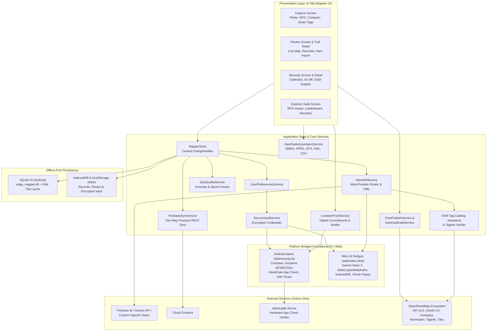
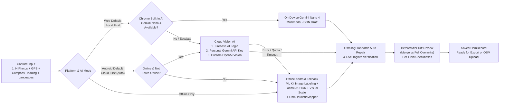
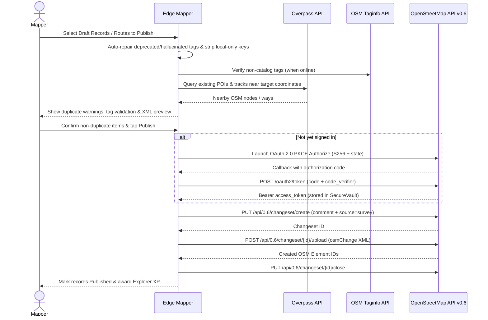

# Edge Mapper — Application Overview

**Edge Mapper** is an offline-first, gamified Flutter application for rapid **OpenStreetMap (OSM)** field surveying and route recording. It is engineered to run smoothly on mid-range Android devices (such as the **Google Pixel 6a** with Tensor G1 / 6 GB RAM, on both stock Android and GrapheneOS) as well as **Linux / Desktop Web** via Google Chrome.

> For a detailed analysis of the app's security controls, cryptographic primitives, threat model, and known limitations, see [`SECURITY.md`](SECURITY.md).

---

## 1. What Edge Mapper Does

Mapping in the real world often happens where cellular coverage is unreliable, typing OSM tags on a phone screen is slow, and GPS fixes drift near buildings or under tree canopy. Edge Mapper streamlines the entire **capture → tag → verify → publish** loop:

1. **Snap & Locate (Street, Park & Trail POIs)**
   - Captures single or multi-angle photos alongside live **GPS coordinates** (latitude, longitude, altitude, accuracy), **GPS quality/anomaly diagnostics**, and a native **compass azimuth** (degrees + cardinal direction).
   - Extrapolates the mapped feature's true position forward along the camera heading using an AI/OCR-estimated distance and an interactive **2D Fine Pin Position Pad** (±5 m / ±15 m / ±40 m).
   - Reads embedded **JPEG EXIF GPS & heading metadata** when importing gallery photos.

2. **Hybrid Multi-Provider AI Tagging (Online & Offline)**
   - Extracts structured OpenStreetMap tags, summaries, field notes, and visual distance estimates from photos—including merging multiple angles of the same feature.
   - Runs **Cloud First** on Android (Firebase AI Logic, personal Gemini API key, or OpenAI-compatible Vision API) and **Local First** on Desktop Web (**Gemini Nano 4** via Chrome's Built-in AI Prompt API, with one-tap escalation to Firebase AI).
   - Falls back cleanly to **100% offline ML Kit Image Labeling + Multilingual OCR** (Latin, Japanese, Chinese, Korean) + deterministic OSM heuristics on Android when offline.
   - Always enforces a **Before/After Diff Review** with per-field and per-tag checkboxes before applying AI **Merge (Add Missing Tags)** or **Overwrite (Reset & Re-analyze)** updates.

3. **Standards-Compliant OSM Tagging & Dual-Language Support**
   - Generates `name`, `name:<country_lang>`, and `name:<user_lang>` tags based on the user's configured confident languages and fallback language.
   - Provides a searchable catalog of **160+ real OSM tags** ranked by probability of matching the scene.
   - Automatically repairs hallucinated or deprecated OSM tags (for example, remapping `fitness_equipment` → `fitness_station`, folding `day_off` into `opening_hours`, excluding local-only metadata before publishing) and validates tags against the live **OSM Taginfo API v4**.

4. **General Activity Route Recorder, Offline Map & Ham Radio GPS Import**
   - Records city walks, park strolls, hikes, cycling, and accessible routes with full searchable OSM `highway`, `surface`, `smoothness`, `sac_scale`, `wheelchair`, and `lit` tags.
   - Displays an interactive **OSM Slippy Tile Map** with persistent disk tile caching, an offline area pre-downloader, and existing OSM building/POI overlays.
   - Auto-guesses route names and activity context via Nominatim (or defers guessing until back online).
   - Imports external **Ham radio and handheld GPS tracks**: **NMEA-0183** (Icom/Yaesu/Kenwood), **APRS** (TNC2, Mic-E, Base-91 compressed packets with callsign filtering), **GPX**, **KML**, and **CSV** (Anytone, aprs.fi, APRSdroid), with a dedicated `TrailDetailScreen` to inspect and clean noisy GPS points.

5. **Duplicate Detection & Direct OpenStreetMap Publishing**
   - Checks the **Overpass API** and the local batch before upload to warn about duplicate POIs or overlapping tracks.
   - Signs in via one-tap **OpenStreetMap OAuth 2.0 (PKCE)** against either **Live OpenStreetMap** (`api.openstreetmap.org`) or the **OSM Dev Sandbox** (`master.apis.dev.openstreetmap.org`).
   - Previews and validates XML before pushing **OSM API v0.6 changesets** (`osmChange`) or **GPX traces** (`/api/0.6/gpx/create`), and also exports `.osm`, `.gpx`, and `.geojson` files locally.

6. **Gamified Explorer Guild, Cryptographic Capture Proofs & Bitcoin Bounties**
   - Awards XP, ranks, streaks, badges, and a procedurally rendered **RPG Explorer Avatar** whose gear evolves as you map.
   - Queries real nearby OpenStreetMap contributors via OSM API v0.6 changesets to display a local **Explorer Guild Leaderboard** (cached offline).
   - Generates privacy-preserving **Cryptographic Location Proofs** (salted SHA-256 photo/spatial commitments + coarse Geohash + AndroidKeyStore ECDSA P-256 signature) verifiable without revealing the raw photo.
   - Supports social **Bitcoin mapping bounties** and developer donations via Taproot (`bc1p...`), BIP-352 Silent Payments (`sp1...`), Lightning Address, BOLT 12 / BIP-321 URIs, and BTCPay Server with offline QR generation.

---

## 2. High-Level System Architecture

---

## 3. Navigation & Screen Flow

Edge Mapper adapts across phones, tablets, and desktop browsers via `HomeShell` (`lib/screens/home_shell.dart`):

| Tab / Screen | Primary Purpose | Key Widgets & Flows |
| :--- | :--- | :--- |
| **1. Capture** (`CaptureScreen`) | Rapidly photograph & tag a POI | Multi-photo shutter/gallery picker, live `CompassBadge`, `GpsWarningBanner`, distance slider & `FinePinPositionPad`, `OsmTagSelectorSheet`, `AiUpdateActionsCard`, `LocationProofSheet` |
| **2. Routes** (`TrailScreen` → `TrailDetailScreen`) | Record or import linear routes | Interactive `OsmMapWidget` (offline tile cache + area pre-download + mapped feature inspector), activity/highway/surface tag pickers, `HamRadioImportSheet`, point-level track cleanup |
| **3. Records** (`RecordsScreen` → `RecordDetailScreen`) | Review, enrich, sync & publish drafts | `FirebaseBackupBanner`, batch AI enrichment, `EnrichmentDiffSheet` (Merge vs Overwrite), multi-photo AI merging, `OsmPublishSheet` (duplicate check + XML preview + upload), `.osm`/`.gpx`/`.geojson` export |
| **4. Explorer Guild** (`CommunityScreen`) | Gamification, bounties & verification | `MapperQuestBar`, `ExplorerAvatarWidget`, nearby OSM Guild Leaderboard, Bitcoin mapping bounties (`BitcoinDonateSheet`), standalone `LocationProofSheet` verifier |
| **Settings Modal** (`AiStatusSheet`) | Configuration, AI & Vault management | AI engine & model selector, dual-language config, `OsmAuthSheet`, Security Vault (OS Keystore / Biometrics / Passkey PRF / Passphrase), `.env` exporter, Bitcoin developer donations |

---

## 4. Hybrid AI Pipeline

Edge Mapper routes multimodal analysis dynamically based on platform, connectivity, and user preference (`lib/services/hybrid_ai_service.dart`):

---

## 5. End-to-End OpenStreetMap Publishing Workflow

Before any data touches OpenStreetMap, Edge Mapper runs duplicate detection, tag standardization, and explicit user review:

---

## 6. Cross-Platform Capability Matrix

Platform-specific I/O is isolated behind conditional imports (`*_io.dart` vs `*_web.dart`) so a single Dart codebase builds both Android APKs and Flutter Web bundles:

| Capability | Android (Pixel 6a / GrapheneOS / Newer) | Linux / Desktop Web (Chrome HTTPS) |
| :--- | :--- | :--- |
| **Default AI Mode** | Cloud First (`Auto`) → Offline ML Kit + OCR | Local First (`Gemini Nano 4` → Firebase AI) |
| **Local Storage** | SQLite v5 (`edge_mapper.db`) + disk tile cache | IndexedDB (`edge_mapper_storage_v1`) + `localStorage` |
| **Compass & Sensors** | Native Android `SensorManager` EventChannel + `geolocator` | Browser Geolocation API (manual/EXIF heading) |
| **Secrets Vault** | `AndroidKeyStore` AES-256-GCM (StrongBox/TEE), OS Biometrics, PBKDF2 | Non-extractable WebCrypto key (IndexedDB), WebAuthn Passkey PRF (Bitwarden/YubiKey), PBKDF2 |
| **Firebase App Check** | Custom `AttestGateAppCheckProvider` (Hardware Key Attestation, Play-Services-free) | Optional reCAPTCHA v3 (disabled unless site key is configured) |
| **Location Proof Signing** | `AndroidKeyStore` ECDSA P-256 (`SHA256withECDSA`) | Software commitment HMAC fallback |
| **OSM OAuth Return** | Deep link `edgemapper://oauth2/callback` | Same-origin popup `https://<host>/osm_callback.html` |
| **Ham Radio File Picker** | Android Storage Access Framework (`ACTION_OPEN_DOCUMENT`) | HTML5 File Input |

---

## 7. Data Model Overview

Edge Mapper persists five primary tables/stores locally (SQLite schema v5):

- **`osm_records`**: Captured POIs with multi-photo paths & per-photo EXIF/GPS locations, extrapolated coordinates, heading, distance reasoning, OSM tags, AI provenance, status (`draft` / `enriched` / `published`), `location_proof_json`, and `local_proof_salt`.
- **`hike_trails` & `trail_points`**: Recorded or Ham-radio-imported routes with activity type, OSM way tags, elevation/distance metrics, deferred Nominatim location-guess flags, and timestamped GPS tracks.
- **`mapping_bounties`**: Social mapping quests with target zone, requested OSM tags, satoshi reward, proof requirement flag, and claim submissions.
- **`app_settings`**: Non-sensitive preferences (languages, AI model selection, offline map radius, explorer handle/avatar). All sensitive tokens and API keys are routed out of `app_settings` into `SecureVaultService`.
