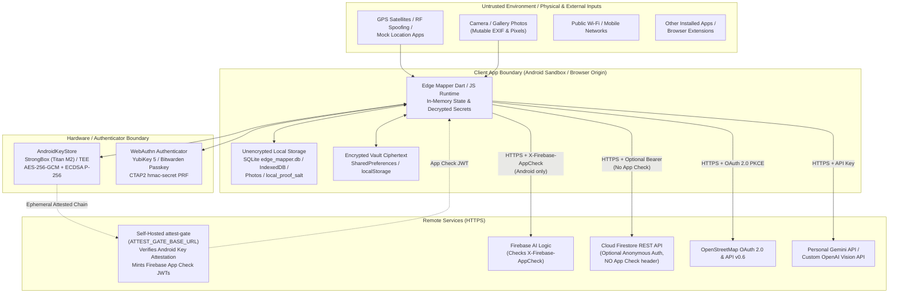
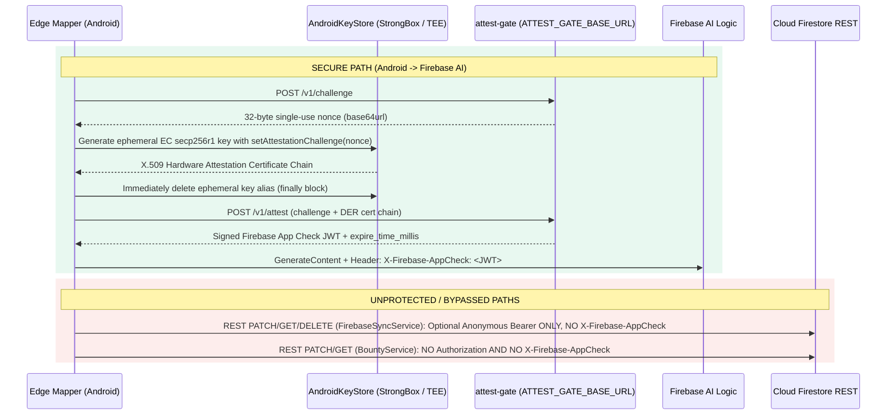
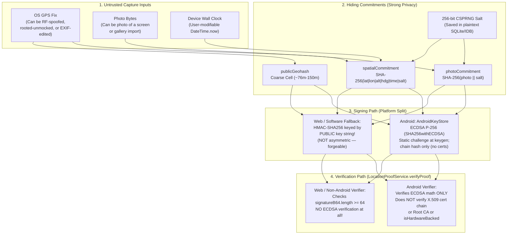
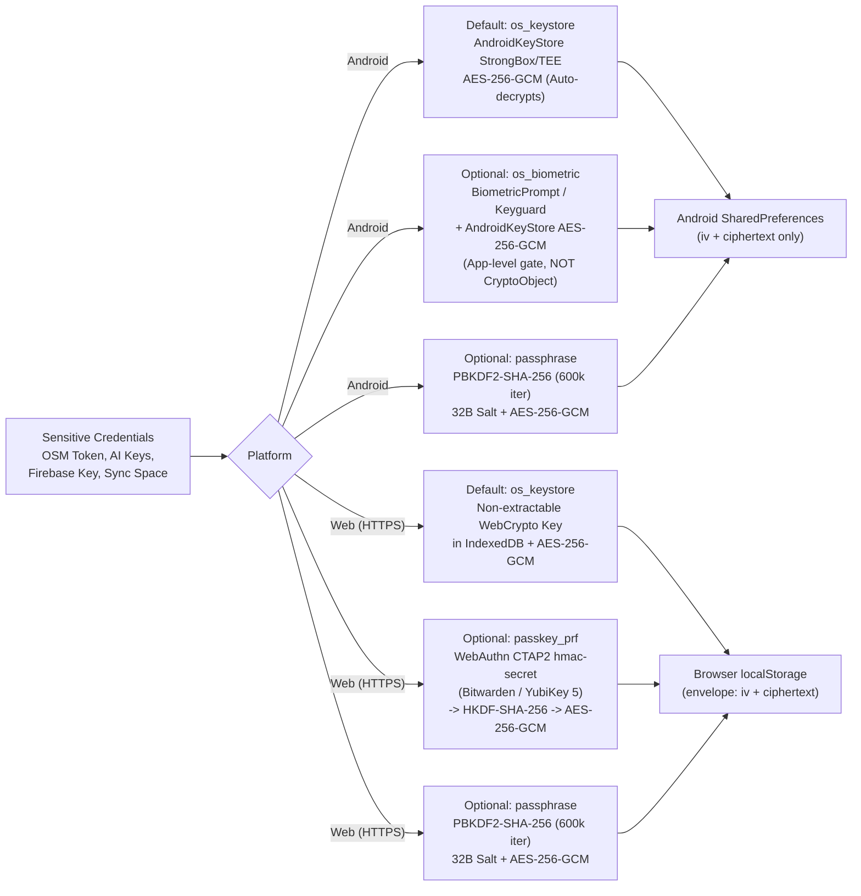
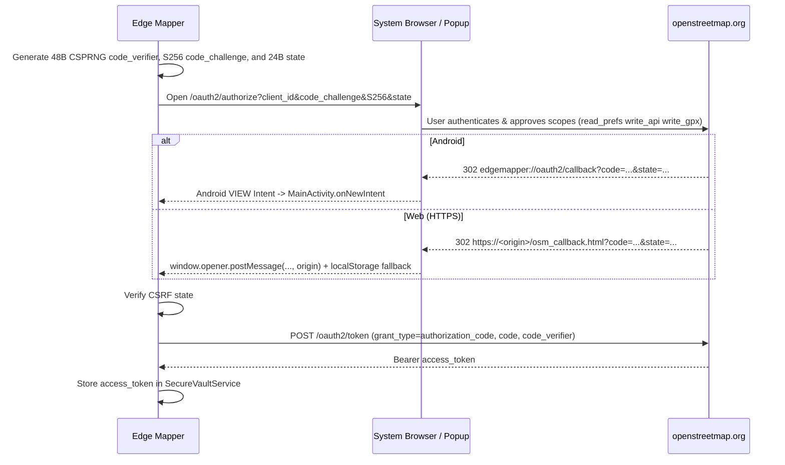

# Edge Mapper — Security Architecture & Honest Threat Assessment

This document provides a transparent, code-verified review of **Edge Mapper's** security posture. For each subsystem, it distinguishes **what is genuinely secure** from **what is not secure (or has important limitations)** so developers, reviewers, and users can reason accurately about trust boundaries.

> All claims in this document reflect the actual implementation in `lib/`, `android/`, and `web/`.

---

## 1. Threat Model & Trust Boundaries

Edge Mapper is a **client-side, offline-first field mapping app**. It has no central proprietary backend holding user accounts; instead, it connects directly to OpenStreetMap, Firebase (AI Logic + optional Firestore sync), a self-hosted `attest-gate` attestation service (Android), and optional user-supplied AI endpoints.



### Executive Summary Matrix

| Subsystem | What IS Secure | What is NOT Secure / Key Gaps |
| :--- | :--- | :--- |
| **Firebase App Check (`attest-gate`)** | Android uses StrongBox/TEE Hardware Key Attestation with single-use nonces, Play-Services-free (works on GrapheneOS). Endpoint is configurable via `ATTEST_GATE_BASE_URL` in `.env`. `firebase_ai` attaches `X-Firebase-AppCheck` automatically on Android. | **Web has no App Check** by default (no reCAPTCHA site key passed). **Firestore REST sync & Bounties never send `X-Firebase-AppCheck`**. No TLS pinning on `attest-gate` calls, fail-open init. |
| **GPS Cryptographic Location Proof** | Photo & exact coordinates stay private via 256-bit salted SHA-256 commitments + coarse Geohash. Android signs with non-exportable Keystore ECDSA P-256 key. | **Does NOT cryptographically prove physical presence.** No X.509 attestation chain verification; `isHardwareBacked` isn't signed; **Web verifier checks string length only**; **Web/software fallback uses HMAC keyed by the public key (trivially forgeable)**; vulnerable to RF GPS spoofing, post-hoc minting, and clock manipulation. |
| **Encrypted Credentials Vault** | Secrets isolated from plaintext settings; AES-256-GCM; AndroidKeyStore StrongBox/TEE; WebAuthn Passkey PRF (Bitwarden/YubiKey) + HKDF; PBKDF2-SHA-256 (600k iterations); RAM wipe on lock. | Android `os_biometric` mode is a **UI boolean gate**, not a Keystore `setUserAuthenticationRequired(true)` `CryptoObject`-bound key (bypassable under root/Frida). Default `os_keystore` auto-decrypts on launch. Min passphrase is 6 chars. Compile-time `.env` keys are extractable from APK/JS bundles. |
| **OSM OAuth 2.0 PKCE** | Proper PKCE `S256` (48-byte CSPRNG verifier), 24-byte `state`, minimal scopes, origin-checked `postMessage`, token stored in vault. | Android custom scheme `edgemapper://` can be registered by other apps (PKCE prevents token theft, not DoS). Web `localStorage` fallback briefly holds code. Web bridge skips `state` check if an injected payload omits `state`. |
| **Cloud Sync & Bounties (Firestore)** | HTTPS transport; optional (can run 100% offline). | `sync_space_id` is a shared-secret path under **Anonymous Auth** (or unauthenticated fallback) — no real per-user ACL. `mapping_bounties` sends **zero auth headers**. Bitcoin bounties are social honor-system, not escrow. |
| **Local Data & Privacy** | App sandbox isolation; `.env` export strips secrets by default; non-custodial Bitcoin. | SQLite DB, IndexedDB, photos, GPS tracks, and `local_proof_salt` are **unencrypted** at app level. Cloud AI & OSM APIs receive exact GPS + unredacted photos. Android `allowBackup` is not explicitly disabled. |

---

## 2. Firebase App Check & `attest-gate`

Files: `lib/attest_gate_provider.dart`, `android/app/src/main/kotlin/com/edgemapper/attestation/AttestGateAppCheckProvider.kt`, `android/app/src/main/kotlin/com/edgemapper/app/MainActivity.kt`, `lib/main.dart`, `lib/services/firebase_sync_service.dart`, `lib/services/bounty_service.dart`.

### How It Works Today



### What IS Secure
1. **Zero Google Play Services / GrapheneOS Compatible**: Instead of Play Integrity, Android uses `AttestGateAppCheckProvider` backed directly by Android Hardware Key Attestation (`KeyGenParameterSpec.setAttestationChallenge`).
2. **StrongBox Preferred with Hardware TEE Fallback**: On Android 9+ (API 28+), the provider requests `setIsStrongBoxBacked(true)` (e.g., Pixel 6a's Titan M2 chip) and falls back to hardware TEE if unavailable.
3. **Replay Protection & Key Hygiene**: Every attestation fetch pulls a fresh 32-byte server challenge from `/v1/challenge`, binds it to an ephemeral `secp256r1` key, extracts the X.509 chain, and immediately deletes the key alias in a `finally` block so Keystore slots cannot leak.
4. **Correct FlutterFire Wiring on Android**: Installs `AttestGateAppCheckProviderFactory` natively and calls `setTokenAutoRefreshEnabled(true)` *without* calling `FirebaseAppCheck.instance.activate(...)` (which would overwrite the custom factory), ensuring `firebase_ai` automatically attaches `X-Firebase-AppCheck`.

### What is NOT Secure (App Check Gaps)
1. **Web Has No App Check Enabled**: In `lib/main.dart`, `AttestGateAppCheck.initialize(attestGateBaseUrl: ...)` is called **without** `webRecaptchaSiteKey`. In `lib/attest_gate_provider.dart`, an empty site key causes Web to return early without activating App Check.
   - *Consequence*: Either Firebase App Check is **not enforced** on the Firebase backend (meaning attackers can call Firebase AI directly using the public Firebase API key from outside the app), OR enforcing App Check breaks the Web app completely.
2. **Firestore Sync & Bounties Bypass App Check Completely**: `FirebaseSyncService` and `BountyService` talk to `firestore.googleapis.com` using raw `http.Client` REST requests instead of the Firebase Firestore SDK. Neither service fetches or attaches an `X-Firebase-AppCheck` header.
3. **Verifier Single Point of Trust & No TLS Pinning**: Although `ATTEST_GATE_BASE_URL` is configured via `.env` (allowing forks to substitute their own verifier), `HttpURLConnection` does not perform TLS certificate pinning. Compromise of the `attest-gate` host or its Firebase service account private key allows minting arbitrary App Check tokens.
4. **Fail-Open Initialization**: `lib/main.dart` wraps `AttestGateAppCheck.initialize(...)` in a `try/catch` that logs and continues booting. Security therefore depends entirely on server-side App Check enforcement in Firebase Console.
5. **App Integrity ≠ Truthful Field Data**: App Check verifies *that requests come from a hardware-attested device running an authorized APK*. It does **not** guarantee that GPS coordinates or photos submitted by that device are real.

---

## 3. GPS Cryptographic Location Proof

Files: `lib/services/location_proof_service.dart`, `lib/models/location_proof.dart`, `lib/services/crypto_proof_bridge_*.dart`, `android/app/src/main/kotlin/com/edgemapper/app/MainActivity.kt`, `lib/screens/record_detail_screen.dart`.

### How It Works vs. Where Trust Breaks Down



### What IS Secure
1. **Privacy-Preserving Commitments (Hiding Property)**: A fresh 32-byte `Random.secure()` salt prevents brute-forcing exact coordinates or matching photos against the published proof. Third parties only see the coarse Geohash cell (default precision 7, ~±76–150 m) and opaque SHA-256 hashes.
2. **Optional Selective Reveal**: If an auditor later requests proof that a specific photo corresponds to a proof, `LocationProofService.verifyPhotoReveal()` checks `computePhotoCommitment(photoBytes, salt) == proof.photoCommitment`.
3. **Non-Exportable Signing Key on Android**: On Android, `edge_mapper_capture_ecdsa_p256_v1` lives inside `AndroidKeyStore` (TEE/StrongBox) and signs `_buildHardwareSignableEnvelope(proof)` using `SHA256withECDSA`. Any modification to the signed envelope fields invalidates the signature when verified on Android.
4. **Basic Anti-Spoof Heuristics**: `GpsQualityService` and `verifyProof` detect and flag obvious client-side issues: Null Island `(0,0)`, Android's `Position.isMocked` flag, sudden teleport jumps (>120 m at >45 m/s or ≤3 s), stale fixes (>45 s), poor accuracy (>65–75 m), and capture-to-fix lag (>30 s).

### What is NOT Secure (Why This Is NOT Trustless Proof-of-Location)

> **Important:** Edge Mapper's `LocationProof` is best understood as a **tamper-evident, privacy-preserving capture receipt** — NOT a cryptographically unforgeable proof that a human physically visited a GPS location.

1. **No Hardware Attestation Chain Verification (Forged "Hardware-Backed" Claims)**:
   - When creating `edge_mapper_capture_ecdsa_p256_v1` in `MainActivity.kt`, the app passes a **static** attestation challenge (`"edge-mapper-proof-v1"`) and exports only `attestationChainHash` (a SHA-256 digest of the cert chain) — **not** the X.509 certificates themselves.
   - `verifyProof()` never validates any certificate chain against Google's Hardware Attestation Root CA.
   - Furthermore, `isHardwareBacked` and `hardwareSecurityLevel` are **excluded** from `_buildHardwareSignableEnvelope()`. An attacker can generate an arbitrary software ECDSA P-256 keypair, sign fabricated coordinates, and set `"isHardwareBacked": true, "hardwareSecurityLevel": "strongbox"` in the proof JSON — and it will pass as `ProofTrustTier.hardwareAttested`!
2. **Web / Non-Android Verifiers Do NOT Verify ECDSA Signatures**:
   - In `location_proof_service.dart` (lines 330–337), when `nativeVerifySignature` returns `null` (always true on Web and desktop), the verifier falls back to:
     ```dart
     sigValid = proof.signatureB64.length >= 64 && proof.publicKeyB64.length >= 64;
     ```
   - Any 64+ character dummy Base64 strings pass signature verification on Web!
3. **Web & Software Fallback Signature Is Completely Forgeable**:
   - `_computeSoftwareDigestSignature` computes `HMAC-SHA256(key = "edge-mapper-proof::" + publicKeyB64, msg = canonicalPayload)`.
   - Because `publicKeyB64` is a **public field inside the proof JSON**, there is no secret key at all. Anyone can modify coordinates, timestamps, or `isMockedGps`, recompute the HMAC using the public key string, and produce a proof that `verifyProof()` marks `isValid = true` (`ProofTrustTier.signedCommitment`).
4. **The Analog / Sensor Gap (GPS & Camera Are Untrusted)**:
   - Android delivers GPS coordinates and JPEG bytes to user-space before signing. There is no hardware GNSS authentication (e.g., Galileo OSNMA or verified raw GNSS navigation messages) and no camera-hardware-to-TEE signing pipeline (such as hardware C2PA).
   - `isMockedGps` only catches standard Developer Options mock providers. It is defeated by external SDR/RF GPS spoofers (e.g., HackRF), rooted/Xposed/Magisk hooks that clear `isMocked`, taking a photo of a monitor, or repackaging the APK.
5. **Post-Hoc Proof Generation & Backdating**:
   - `RecordDetailScreen._generateProofNow()` lets a user mint a fresh proof *after capture* from an already-saved record, passing `capturedAt: _record.createdAt` while leaving `isMockedGps = false` and `captureToFixDeltaMs = 0` at their defaults.
   - `capturedAtIso` trusts the local device clock with no RFC 3161 trusted timestamp or external witness.
6. **Plaintext Local Salt Storage**:
   - `local_proof_salt` is stored in plaintext in the `osm_records` SQLite table (and Web IndexedDB/localStorage), not in `SecureVaultService`.

---

## 4. Encrypted Credentials Vault

Files: `lib/services/secure_vault_service.dart`, `lib/services/secure_vault_backend_{io,web}.dart`, `android/app/src/main/kotlin/com/edgemapper/app/MainActivity.kt`, `web/index.html`, `lib/services/user_preferences_service.dart`.

Protected secret keys: `osm_access_token`, `personal_gemini_api_key`, `custom_ai_api_key`, `custom_firebase_api_key`, `sync_space_id`, `osm_client_id`.



### What IS Secure
1. **Clean Separation from Plaintext Settings**: Sensitive keys are never written to SQLite `app_settings` or plaintext Web settings JSON.
2. **Modern Authenticated Encryption & KDF**: Uses **AES-256-GCM** with fresh random 96-bit IVs per write, **PBKDF2-HMAC-SHA-256 with 600,000 iterations** (aligned with OWASP 2023+ guidance) and 32-byte random salts, and **HKDF-SHA-256** domain-separated key derivation for WebAuthn PRF.
3. **Real Hardware-Backed Key Protection**:
   - Android prefers **StrongBox** (`setIsStrongBoxBacked(true)`) with hardware TEE fallback.
   - Web supports **W3C WebAuthn Passkey PRF** (`hmac-secret`) with `userVerification: 'required'` for YubiKey 5 / Bitwarden Passkeys, and deletes the old IndexedDB device key (`deleteDeviceKey()`) upon upgrading to Passkey or Passphrase mode.
4. **In-Memory Zeroization on Lock**: Calling `vault.lock()` clears Dart maps (`_secrets.clear()`), native Kotlin caches (`cachedVaultJson = null`, `activePassphraseKey = null`), and Web JS caches (`activeCryptoKey = null`, `cachedSecrets = null`).

### What is NOT Secure (Vault Limitations)
1. **Android `os_biometric` Mode Is Not Hardware Auth-Bound**:
   - `VAULT_AES_KEY_ALIAS` in `MainActivity.kt` is created **without** `.setUserAuthenticationRequired(true)` and without passing a `Cipher` via `BiometricPrompt.CryptoObject`.
   - Instead, `promptOsAuthentication()` sets an in-memory boolean (`vaultUnlockedForSession = true`) and then calls the unrestricted Keystore key. Additionally, `BIOMETRIC_WEAK` is accepted alongside `BIOMETRIC_STRONG` and `DEVICE_CREDENTIAL`.
   - *Impact*: Protects against casual physical access to an unlocked phone, but **does not** resist runtime instrumentation (Frida/root) bypassing the UI callback.
2. **Default `os_keystore` Mode Auto-Decrypts Without User Presence**:
   - On both Android and Web, default mode prevents casual inspection of SharedPreferences/`localStorage` files, but any code executing inside the app process (or an XSS payload on Web) can read decrypted secrets immediately on startup.
3. **Weak Minimum Passphrase Length**:
   - Both Android and Web enforce a minimum of only **6 characters** (`passphrase.length < 6`). If the ciphertext + salt are stolen from disk/`localStorage`, a short 6-character passphrase can still be brute-forced offline despite 600k PBKDF2 iterations.
4. **Web XSS Boundary**:
   - Once unlocked in a browser tab, decrypted secrets remain in JS/Dart memory until locked or the tab closes. Any same-origin XSS vulnerability can read them or tamper with `window.edgeMapperVault`.
5. **Compile-Time `.env` Secrets Are Embedded in Binaries**:
   - Values passed via `--dart-define-from-file=.env` (`String.fromEnvironment`) are compiled directly into `libapp.so` (Android) or `main.dart.js` (Web).
   - *Rule*: Only ship **public** identifiers (`FIREBASE_*`, `OSM_CLIENT_ID`, `BTC_DONATION_*`) in distributed builds. Never bake private paid API keys (`GEMINI_API_KEY`, `CUSTOM_AI_API_KEY`) into public APKs or hosted Web bundles.

---

## 5. OpenStreetMap OAuth 2.0 PKCE

Files: `lib/services/osm_publish_service.dart`, `lib/services/osm_browser_bridge_{io,web}.dart`, `web/osm_callback.html`, `android/app/src/main/AndroidManifest.xml`, `android/app/src/main/kotlin/com/edgemapper/app/MainActivity.kt`.



### What IS Secure
- **RFC 7636 PKCE (`S256`)** with a 48-byte cryptographically secure random verifier and 24-byte `state` parameter; no OAuth `client_secret` is embedded in the public client.
- **Least-Privilege Scopes**: Requests only `read_prefs write_api write_gpx`.
- **Origin-Restricted Web Messaging**: `web/osm_callback.html` targets `window.location.origin` (not `*`), and `osm_browser_bridge_web.dart` drops messages where `event.origin != web.window.location.origin`.
- **Vaulted Token Storage**: The Bearer token is stored in `SecureVaultService`.

### What is NOT Secure (OAuth Nuances)
1. **Custom URI Scheme on Android (`edgemapper://oauth2/callback`)**: Unlike Android Verified App Links (`https://` backed by `assetlinks.json`), another malicious app on Android can claim the `edgemapper://` scheme and intercept the redirect. **PKCE prevents token exchange** (the attacker lacks `code_verifier`), so account takeover is prevented, but login hijacking/DoS remains possible.
2. **Web Callback `state` Edge Case**: In `lib/services/osm_browser_bridge_web.dart` (line 72), the check reads `if (state.isNotEmpty && state != expectedState) return;`. If a same-origin script injected a forged `localStorage`/`postMessage` payload with an **empty** `state`, it would bypass that guard (unlike `parseOAuthCallbackUri`, which rejects missing state).
3. **Temporary `localStorage` Exposure on Web**: `osm_callback.html` writes the authorization `code` into `localStorage` (`edge_mapper_osm_oauth_result`) as a fallback when `window.opener` is lost; it is removed once consumed.
4. **Long-Lived Bearer Tokens**: OpenStreetMap OAuth 2.0 access tokens do not auto-expire quickly. If extracted from an unlocked device/session, the token grants write access to the user's OSM account until manually revoked on `openstreetmap.org`.

---

## 6. Cloud Firestore Sync, Bounties & Bitcoin

Files: `lib/services/firebase_sync_service.dart`, `lib/services/bounty_service.dart`, `lib/services/bitcoin_service.dart`.

### What IS Secure
- **Non-Custodial Bitcoin**: Edge Mapper never generates, stores, or touches Bitcoin private keys, seeds, or funds. It strictly validates address/URI formats (Taproot `bc1p`, SegWit `bc1q`, BIP-352 Silent Payments `sp1`, Lightning Address, BOLT 12, BIP-321, BTCPay URL), renders offline QR codes, and hands off to the user's external wallet.
- **Opt-In Cloud Sync**: Users can keep all data strictly local/offline and disable sync prompts permanently.

### What is NOT Secure
1. **Sync Space Is a Shared-Secret Path, Not User Access Control**:
   - `FirebaseSyncService` authenticates via **Firebase Anonymous Auth** (and silently proceeds **unauthenticated** if Anonymous Auth is disabled in Firebase Console).
   - Documents are stored under `sync_spaces/<syncSpaceId>/osm_records` — or directly in root `osm_records` and `trails` when `syncSpaceId` is empty!
   - If Firestore Security Rules allow `request.auth != null`, **any user of the app can read, modify, or delete** records (including base64-encoded user photos) in the default root collections or any guessable `syncSpaceId`.
2. **Unauthenticated `mapping_bounties` Collection**:
   - `BountyService._pushBountyToFirestore()` and `refreshFromFirestore()` send plain REST requests to `mapping_bounties` with **no `Authorization` header and no `X-Firebase-AppCheck` header**. If Firestore rules allow public writes so the feature works, anyone with the Firebase project ID can spam, overwrite, or replace bounty payout Bitcoin addresses (`mapperBtcAddress`)!
3. **Honor-System Bounties (No Trustless Escrow)**:
   - Bounty claims run `LocationProofService.verifyProof()` **client-side** on the claimer's device and write `proofVerified: true` into the submission JSON. There is no server-side verification, no escrow, and no atomic swap — payouts rely on social trust and manual verification by the bounty creator.

---

## 7. Local Storage, Third-Party Privacy & Build Hardening

### Local Data at Rest
- **Not Encrypted by the App**: `edge_mapper.db` (SQLite v5 on Android), `edge_mapper_storage_v1` (IndexedDB on Web), cached OSM tiles, captured photos, GPS tracks, and `local_proof_salt` are stored in plaintext within the OS app sandbox / browser profile.
  - On Android, confidentiality at rest relies on Android File-Based Encryption (FBE) and the OS app sandbox (compromised if the device is rooted or ADB backup/extraction is abused).
  - `android/app/src/main/AndroidManifest.xml` does **not** explicitly set `android:allowBackup="false"`, which can expose app data to cloud/ADB backups depending on Android version and device policy.

### Third-Party Privacy Exposure (Online Mode)
When online features are used, the following metadata leaves the device:
- **Cloud AI Providers** (Firebase AI, Personal Gemini API, or Custom OpenAI-compatible URL): Receive **full captured photos** (which may contain faces, license plates, or private interiors), exact GPS coordinates, altitude, compass heading, and local OCR text.
- **Personal Gemini API Key in Query String**: `HybridAiService` sends the user's personal Gemini key in the URL query parameter (`?key=...`). While supported by Google's REST API, passing it via the `x-goog-api-key` HTTP header is preferable to avoid accidental URL logging in proxies or error reports.
- **OpenStreetMap & Geospatial APIs**: Overpass API, Nominatim reverse geocoding, OSM Tile servers, Taginfo API, and OSM changesets API receive the user's IP address and queried coordinates/bounding boxes.

### Android Build & Network Hardening
- **Zero-Config Debug Key Fallback**: In `android/app/build.gradle.kts`, `release` builds fall back to `signingConfigs.getByName("debug")` if `android/key.properties` is missing. Production releases **must** supply a private release keystore via `android/key.properties` (and register its signing certificate SHA-256 digest with `attest-gate`).
- **No TLS Certificate Pinning / `network_security_config.xml`**: All HTTPS calls trust the OS certificate store (good compatibility, but no pinning against rogue CAs for high-value endpoints like `attest-gate`).

---

## 8. Prioritized Hardening Roadmap

If hardening Edge Mapper for broader public production or financial-grade bounties, address items in this order:

| Priority | Area | Concrete Fix |
| :--- | :--- | :--- |
| **P0** | **Location Proof Verification** | Verify ECDSA P-256 signatures in pure Dart/WebCrypto on Web (remove the `length >= 64` fallback in `location_proof_service.dart`); clearly label software/Web proofs as *unauthenticated checksums* or use WebAuthn/WebCrypto ECDSA P-256 keys; export and verify the full Android Key Attestation X.509 certificate chain against Google's Root CA on a verifier backend; include `isHardwareBacked` and `hardwareSecurityLevel` inside the signed envelope. |
| **P0** | **App Check Coverage** | Configure `webRecaptchaSiteKey` (or Cloudflare Turnstile / custom Web provider) so App Check can be **enforced** in Firebase Console across both Android and Web; attach `X-Firebase-AppCheck` headers to `FirebaseSyncService` and `BountyService` (or migrate them to the official `cloud_firestore` SDK). |
| **P0** | **Firestore Security & Bounties** | Replace anonymous/unauthenticated shared-path sync with real user authentication (e.g. Firebase Auth UID-scoped documents + strict Firestore Security Rules), and authenticate/validate `mapping_bounties` writes server-side (Cloud Functions) so attackers cannot overwrite `mapperBtcAddress` or spoof `proofVerified`. |
| **P1** | **Android Vault Biometrics** | Bind the Android `os_biometric` AES key with `setUserAuthenticationRequired(true)` and unlock via `BiometricPrompt.CryptoObject` (`BIOMETRIC_STRONG` / `DEVICE_CREDENTIAL`), rather than an in-memory boolean gate; raise minimum passphrase length to ≥ 12 characters. |
| **P1** | **OAuth & API Hygiene** | Fix the Web OAuth bridge `state` check (`if (state != expectedState) return;`, rejecting empty state); consider Android Verified App Links (`https://`) alongside PKCE; move Personal Gemini API keys from `?key=` query params to the `x-goog-api-key` HTTP header. |
| **P2** | **Storage, Backup & Config** | Set `android:allowBackup="false"` in `AndroidManifest.xml`; move `local_proof_salt` into `SecureVaultService`; fail release builds in CI if `android/key.properties` is missing; optionally disable post-hoc proof minting in `RecordDetailScreen` or flag post-hoc proofs explicitly in the signed payload. |
